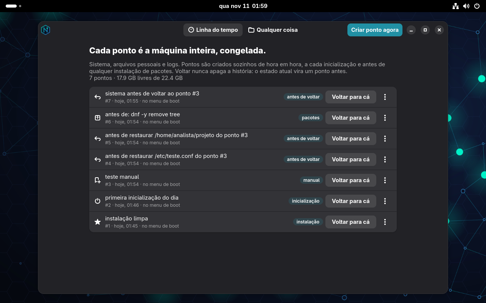
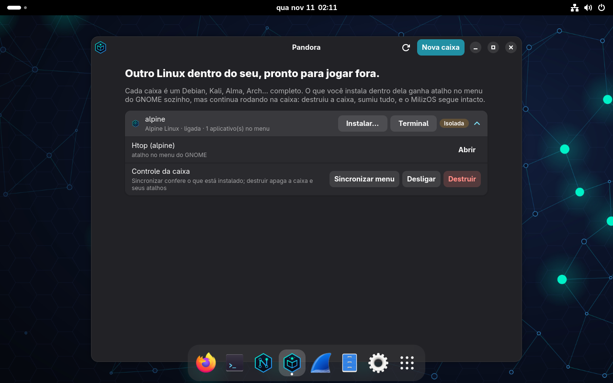
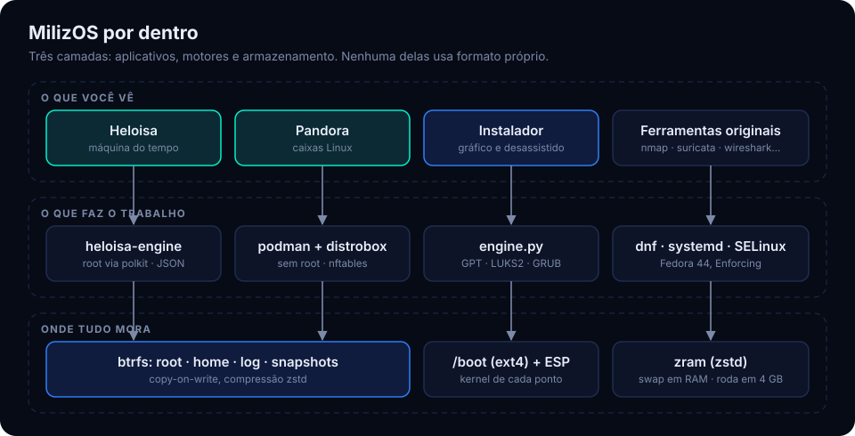

<p align="center"></p>
<h1 align="center">MilizOS</h1>
<p align="center"><b>A distribuição Linux para quem defende: SOC, Blue Team e Engenharia de Redes.</b></p>
<p align="center">
<a href="https://github.com/Daniel-Pereira-Linux/milizos/releases/latest">Baixar a ISO</a> ·
<a href="https://daniel-pereira-linux.github.io/milizos/">Site</a> ·
<a href="docs/MANUAL.md">Manual</a> ·
<a href="docs/ARQUITETURA.md">Por baixo do capô</a> ·
<a href="docs/ADMINISTRADOR.md">Administrador</a> ·
<a href="CONTRIBUTING.md">Como colaborar</a>
</p>

---

O Kali é feito para quem ataca. O **MilizOS** é feito para quem defende: uma distribuição
baseada em Fedora, com instalador próprio, pensada para o analista de SOC, o time de
resposta a incidentes e o engenheiro de redes.

A ideia central da versão 2.0: **um sistema totalmente gravável em que tudo tem história**.
Você pode mexer em qualquer coisa, e qualquer coisa volta a uma versão anterior, como em um
repositório git. Sem comandos próprios para decorar: as ferramentas são as originais.

| | |
|---|---|
| Base | Fedora 44 (x86-64), GNOME, SELinux em *Enforcing* |
| ISO | 3,2 GB, híbrida: BIOS e UEFI, com Secure Boot |
| Memória | roda em **4 GB de RAM** (swap comprimido em zram) |
| Instalador | próprio, gráfico e desassistido; btrfs, xfs ou ext4; LUKS2 opcional |
| Perfis | SOC, Engenharia de Redes, Sensor (IDS sem interface gráfica) |

## Heloisa: a máquina do tempo

Um aplicativo gráfico que volta **qualquer coisa** a uma versão anterior.



- **A máquina inteira.** Cada *ponto* congela o sistema (`/`, `/etc`, `/usr`, `/var`), os
  arquivos pessoais (`/home`) e os logs. Pontos nascem sozinhos de hora em hora, na
  primeira inicialização do dia e antes de cada transação do `dnf`.
- **Qualquer arquivo ou pasta.** Navegue por todo o sistema, veja todas as versões que um
  caminho já teve, compare com um diff colorido e traga de volta: no lugar ou como cópia.
  Inclusive o que foi apagado.
- **Voltar nunca apaga.** Antes de qualquer volta, o estado atual vira um ponto. Dá para
  desfazer o desfazer.
- **Pelo menu de boot.** O GRUB lista os 15 pontos mais recentes, cada um com o seu kernel.
- **Resgate pela mídia.** Se nem o GRUB sobrou, a Heloisa no pendrive restaura um ponto e
  reconstrói o boot.

Nada é formato próprio: os pontos são snapshots btrfs, montados somente leitura em
`/.heloisa`, legíveis com `ls`, `diff` e `cp`.

## Pandora: caixas Linux descartáveis

Debian, Kali, AlmaLinux, Ubuntu, Fedora, Arch, Rocky, openSUSE, Alpine ou Parrot rodando
dentro do MilizOS, em conteiners sem root.

- **Atalho automático.** Instalou um programa na caixa (pelo app ou com o `apt`/`dnf`/`pacman`
  dela) e ele aparece no menu do GNOME, rodando dentro da caixa.
- **Dois modos de rede.** *Isolada*: só sai para a internet; rede local, host e endereços
  privados são recusados, e a pasta pessoal é separada. *Ponte*: usa a rede do host, para
  ferramentas que precisam enxergar a rede.
- **Destruiu, sumiu.** Apagar a caixa leva os programas, os atalhos e a pasta dela. O
  sistema base não é tocado.

As caixas são podman comum: `podman ps` e `distrobox enter` funcionam.



## Atualiza sozinho

Um serviço diário busca no repositório do projeto as correções da Heloisa, da Pandora e do
instalador. A Heloisa cria um ponto antes: toda atualização tem volta.

## Por baixo do capô



Disco, boot, snapshots, rede das caixas e atualização, explicados em
[docs/ARQUITETURA.md](docs/ARQUITETURA.md).

O [manual](docs/MANUAL.md) descreve os dois em detalhe, incluindo os limites.

## Ferramentas

| Categoria | Exemplos |
|---|---|
| Tráfego e captura | Wireshark, tcpdump, tshark, ngrep, tcpflow, tcpreplay, mitmproxy, argus, nfdump |
| Detecção e monitoramento | Suricata, fail2ban, auditd, osquery, sysdig, glances |
| Descoberta e varredura | nmap, masscan, zmap, arp-scan, fping, dnsrecon, gobuster, ffuf |
| Diagnóstico de rede | mtr, iperf3, trippy, bandwhich, gping, ethtool, bpftrace |
| Engenharia de redes | FRR, BIRD, ExaBGP, Ansible, Netmiko, Scapy, WireGuard, strongSwan |
| Forense e análise de malware | Sleuth Kit, YARA, ClamAV, binwalk, rizin, bulk_extractor, ddrescue |
| Senhas e criptografia | hashcat, John the Ripper, hydra, medusa, crunch |
| Redes sem fio e rádio | aircrack-ng, Kismet, hcxtools, GNU Radio, rtl-sdr, HackRF |
| Auditoria e hardening | OpenSCAP, Lynis, AIDE, trivy, rkhunter, testssl |

Só entra na ISO o que existe nos repositórios do Fedora; o que falta (Metasploit e Burp
Suite, por exemplo) roda em uma caixa Kali da Pandora.

## Baixar e instalar

1. Baixe a ISO em [Releases](https://github.com/Daniel-Pereira-Linux/milizos/releases/latest).
   A ISO passa do limite de 2 GB por arquivo do GitHub, entao vai em duas partes. Junte e confira:
   ```bash
   curl -fL --remote-name-all "https://github.com/Daniel-Pereira-Linux/milizos/releases/download/v2.0/MilizOS-2.0-x86_64.iso.part-0[0-1]" "https://github.com/Daniel-Pereira-Linux/milizos/releases/download/v2.0/MilizOS-2.0-x86_64.iso.sha256" \
     && cat MilizOS-2.0-x86_64.iso.part-* > MilizOS-2.0-x86_64.iso \
     && sha256sum -c MilizOS-2.0-x86_64.iso.sha256 && rm MilizOS-2.0-x86_64.iso.part-*
   ```
2. Grave em um pendrive:
   ```bash
   sudo dd if=MilizOS-2.0-x86_64.iso of=/dev/sdX bs=4M status=progress oflag=sync
   ```
3. Inicie pelo pendrive. O instalador abre sozinho no modo live.

Requisitos: x86-64, 4 GB de RAM, 30 GB de disco.
Para a Heloisa funcionar, mantenha o btrfs sugerido pelo instalador.

## Colaborar

Adicionar uma ferramenta é editar uma linha; a Heloisa e a Pandora são Python com GTK4.
O [guia de contribuição](CONTRIBUTING.md) tem a receita de cada um.

## O que foi testado

Testado em QEMU/KVM com 4 GB de RAM: boot live, instalação em btrfs, a Heloisa de ponta a
ponta (pontos, voltar arquivo, pasta e sistema, volta pelo GRUB) e uma caixa isolada da
Pandora com atalho automático. A lista completa, com o que **ainda não** foi testado, está
em [docs/PROBLEMAS-CONHECIDOS.md](docs/PROBLEMAS-CONHECIDOS.md). Não foi testado em hardware real.

## Licença e avisos

Código sob GPL-3.0-or-later; arte e identidade visual sob CC-BY-SA-4.0. Os pacotes
incluídos na ISO mantêm as próprias licenças.

O MilizOS é baseado no Fedora Linux, mas é um projeto independente, sem vínculo com o
Projeto Fedora ou a Red Hat. Use as ferramentas de segurança apenas em sistemas e redes
que você tem autorização para testar.

## Apoie o projeto

O MilizOS é feito por uma pessoa só, no tempo livre. Se ele te ajudou, pague um café:
**Pix, chave e-mail `danielmaraboo@gmail.com`**.

## Autor

Criado por **Daniel Pereira da Silva** ·
[linkedin.com/in/danielpereira-linux](https://www.linkedin.com/in/danielpereira-linux/)
