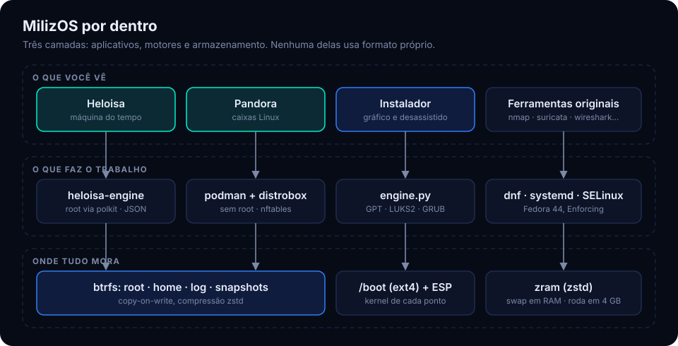
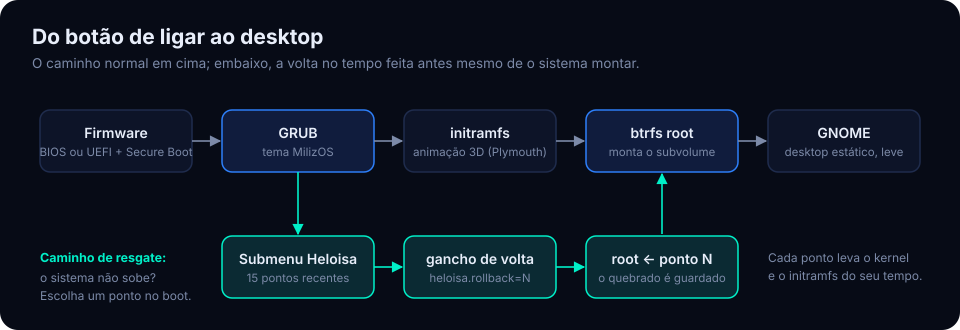
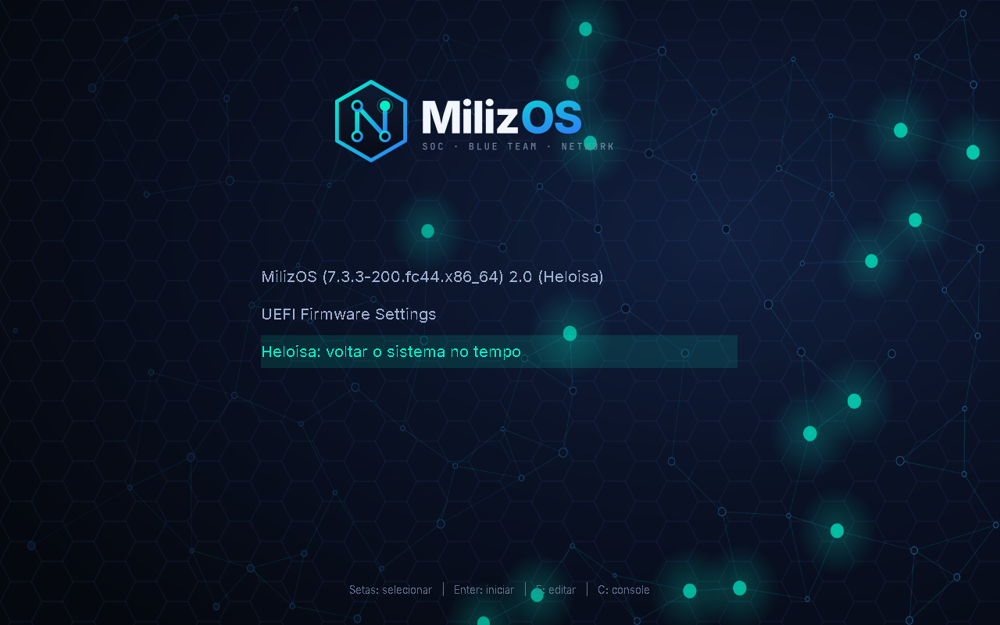
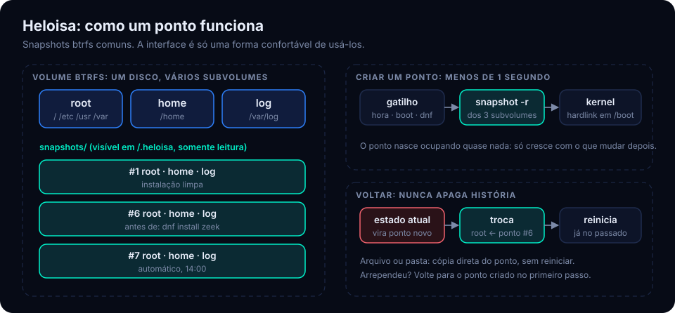
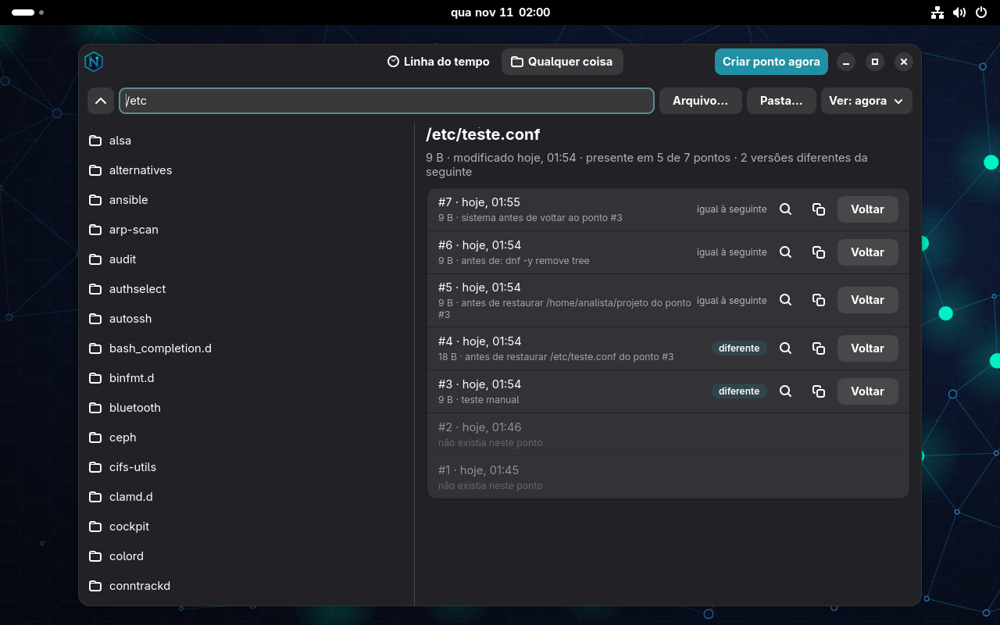
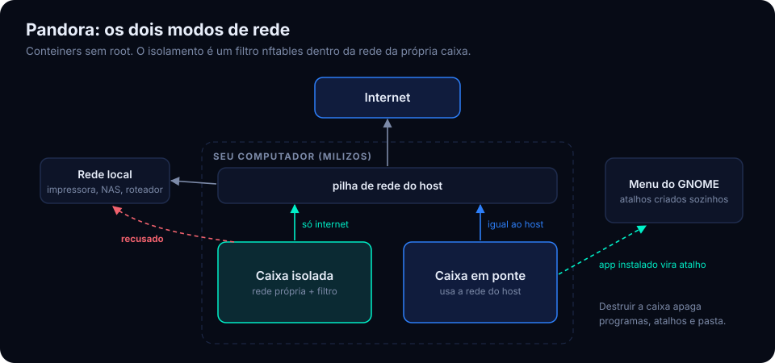
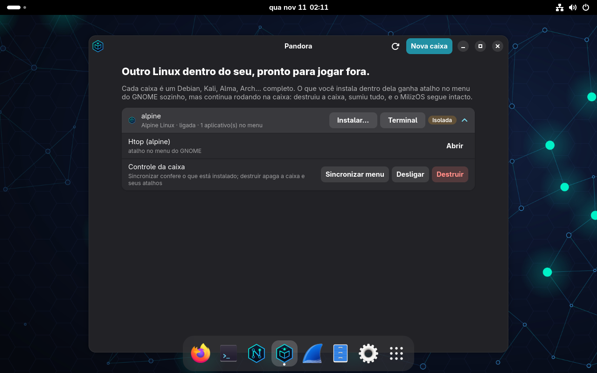

# MilizOS por baixo do capô

Como o sistema funciona de verdade: do disco ao desktop, sem mágica. Se você quer só
usar, o [manual](MANUAL.md) basta; este documento é para quem quer entender, auditar ou
mexer.

- [Visão geral](#visão-geral)
- [O disco](#o-disco)
- [Do botão de ligar ao desktop](#do-botão-de-ligar-ao-desktop)
- [Heloisa](#heloisa)
- [Pandora](#pandora)
- [Atualizações automáticas](#atualizações-automáticas)
- [Memória](#memória)
- [Segurança](#segurança)
- [Onde está cada coisa](#onde-está-cada-coisa)

## Visão geral



O MilizOS é um Fedora 44 com quatro pacotes próprios por cima:

| Pacote | O que carrega |
|---|---|
| `milizos-release` | identidade (`os-release`), serviços padrão, repositório de atualização, ajuste de memória |
| `milizos-branding` | logo, papéis de parede, tema do GRUB, animação 3D do boot |
| `milizos-installer` | instalador gráfico e desassistido, modo live |
| `milizos-tools` | **Heloisa**, **Pandora**, menu de ferramentas, perfil de sensor |

A regra de projeto é uma só: **nada de formato próprio**. A Heloisa guarda a história em
snapshots btrfs comuns; a Pandora usa conteiners podman comuns; as atualizações chegam por
um repositório `dnf` comum. Se os aplicativos sumirem, as ferramentas de sempre continuam
lendo e operando tudo.

## O disco

O instalador cria uma tabela GPT que inicia em BIOS e em UEFI:

| # | Tamanho | Tipo | Para quê |
|---|---|---|---|
| 1 | 1 MiB | BIOS boot | GRUB em máquinas BIOS |
| 2 | 600 MiB | EFI (vfat) | shim e GRUB assinados (Secure Boot) |
| 3 | 1 GiB | ext4 | `/boot`: kernels, initramfs e os kernels de cada ponto |
| 4 | o resto | btrfs (LUKS2 opcional) | todo o sistema |

Dentro da partição btrfs não há pastas soltas, e sim **subvolumes**:

```
(raiz do volume)
├── root        →  /            sistema: /etc, /usr, /var
├── home        →  /home        arquivos pessoais
├── log         →  /var/log     logs (sobrevivem a uma volta do sistema)
└── snapshots   →  /.heloisa    os pontos, somente leitura
    ├── 1/  root/ home/ log/ info.json packages.txt
    ├── 2/  …
    └── …
```

Separar `home` e `log` de `root` é o que permite voltar o sistema sem perder documentos
nem o registro do que aconteceu. Tudo é montado com `compress=zstd:1,noatime`.

## Do botão de ligar ao desktop



1. **Firmware.** Em UEFI, o `shim` assinado carrega o GRUB assinado do Fedora, então o
   Secure Boot pode ficar ligado.
2. **GRUB.** Lê `/boot/grub2/grub.cfg`, que inclui `heloisa.cfg`: o submenu de pontos,
   reescrito pela Heloisa a cada ponto criado ou apagado.
3. **initramfs.** O Plymouth mostra a animação 3D (80 quadros pré-renderizados: custo de
   CPU quase nulo, nenhuma GPU necessária). Se a linha do kernel tiver
   `heloisa.rollback=N`, o gancho `90heloisa` do dracut age **antes de a raiz ser
   montada**: move o subvolume `root` para `snapshots/pre-rollback-K/` e cria um novo
   `root` a partir do ponto N.
4. **Sistema.** `heloisa-boot.service` conclui voltas pendentes (transforma o estado
   anterior em ponto, alinha `/boot` aos kernels do sistema restaurado) e registra o
   ponto de inicialização do dia.
5. **GNOME.** Papel de parede estático, sem extensão de efeito. A animação existe só no
   boot.



## Heloisa



### Peças

| Arquivo | Papel |
|---|---|
| `/usr/lib/milizos/heloisa/engine.py` | toda a lógica; roda como root |
| `/usr/lib/milizos/heloisa/gui.py` | interface GTK4/libadwaita; roda como o usuário |
| `/usr/libexec/milizos/heloisa-engine` | ponto de entrada do motor (não fica no `PATH`) |
| `org.milizos.heloisa.policy` | regra do polkit: pede senha de administrador |
| `heloisa-boot.service`, `heloisa-timeline.timer` | ponto de inicialização e de hora em hora |
| `actions.d/heloisa.actions` | gancho do `dnf`: ponto antes de cada transação |
| `dracut/modules.d/90heloisa` | volta feita no initramfs |
| `/etc/grub.d/42_heloisa` | inclui o submenu no `grub.cfg` |

A interface abre **um** processo privilegiado (`pkexec heloisa-engine serve`) e conversa
com ele por JSON, uma requisição por linha. Uma senha por sessão, e a janela nunca roda
como root.

### Criar um ponto

1. `btrfs subvolume snapshot -r` de `/`, `/home` e `/var/log` para `snapshots/N/`.
2. Hardlink do kernel e do initramfs atuais em `/boot/checkpoints/N/`.
3. `info.json` (quando, tipo, descrição, linha do kernel) e `packages.txt` (`rpm -qa`).
4. Retenção por tipo, trava de espaço e reescrita do submenu do GRUB.

Leva menos de um segundo, e o ponto nasce ocupando quase nada.

### Espaço em disco

O btrfs é *copy-on-write*: um ponto não copia arquivos, só passa a **segurar** os blocos
que existiam naquele instante. O disco só é gasto pelo que muda ou é apagado depois.

- 500 GB de arquivos parados custam zero por ponto.
- Um arquivo de 10 GB apagado continua ocupando 10 GB até o último ponto que o contém
  expirar (no máximo 14 dias para os automáticos).
- **Trava de espaço:** com menos de 15% do disco livre, os pontos automáticos mais antigos
  são apagados até a folga voltar. Pontos manuais e o da instalação nunca saem sozinhos.

### Voltar

- **Sistema, `/home` ou logs inteiros:** o estado atual vira um ponto; o subvolume em uso
  é renomeado e um snapshot gravável do ponto escolhido assume o nome dele. Vale na
  próxima inicialização, e o subvolume antigo é removido no boot seguinte.
- **Arquivo:** `cp -a --reflink` do ponto para o lugar (instantâneo, sem duplicar dados).
- **Pasta:** `rsync -aHAX --delete` do ponto para o lugar: fica idêntica.

Em todos os casos um ponto do tipo "antes de voltar" é criado primeiro. Por isso a
história só cresce, como um `git revert`.



### Resgate

Em modo live não há sistema instalado em uso, então a Heloisa muda de papel: procura
volumes btrfs com a pasta `snapshots/`, restaura o ponto escolhido como `root`, monta
`/boot` e a ESP, reinstala os kernels, o GRUB (BIOS e UEFI) e regenera o `grub.cfg`.

## Pandora



### Peças

| Arquivo | Papel |
|---|---|
| `/usr/lib/milizos/pandora/engine.py` | lógica; roda como o usuário, sem root |
| `/usr/lib/milizos/pandora/gui.py` | interface |
| `/usr/libexec/milizos/pandora-enter` | porta de entrada de toda execução na caixa |
| `pandora-watch.service` (usuário) | leva ao menu o que é instalado nas caixas |

Uma caixa é um conteiner criado com `distrobox create`, marcado com os rótulos
`pandora=1` e `pandora.mode=isolada|ponte`.

### Atalhos automáticos

Enquanto houver caixa ligada, o `pandora-watch` lista a cada poucos segundos os arquivos
`.desktop` de dentro dela. O que é novo em relação ao estado inicial da imagem é exportado
com `distrobox-export` para `~/.local/share/applications/CAIXA-app.desktop`; o que sumiu
tem o atalho removido. O comando do atalho é reescrito para passar por `pandora-enter`.
Sem caixa ligada, o serviço encerra sozinho: custo zero em repouso.

### Rede isolada

No modo isolado a caixa ganha um *namespace* de rede próprio (`--unshare-netns`), ligado
ao mundo pelo `pasta`. Toda vez que a caixa é ligada, o `pandora-enter` aplica, dentro
desse namespace, um conjunto de regras nftables:

```
aceita   loopback, DNS (porta 53) e ICMPv6
recusa   10.0.0.0/8  172.16.0.0/12  192.168.0.0/16  169.254.0.0/16  100.64.0.0/10
recusa   fc00::/7  fe80::/10
aceita   o resto (internet)
```

Não há porta publicada, então nada entra. A pasta pessoal fica em
`~/.local/share/pandora/homes/CAIXA`.

No modo ponte a caixa usa a pilha de rede do host diretamente, como um programa instalado
nele. Os limites dos dois modos estão no [manual](MANUAL.md#limites-1).



## Atualizações automáticas

```
mantenedor                    GitHub Pages                    cada MilizOS instalado
───────────                   ────────────                    ───────────────────────
corrige o código  ──push──▶   /milizos/repo/   ◀──todo dia──  milizos-update.timer
gera os RPMs                  (repositório dnf)                dnf upgrade --repo=milizos
                                                               └─ Heloisa cria um ponto antes
```

- `/etc/yum.repos.d/milizos.repo` aponta para o repositório do projeto.
- `milizos-update.timer` dispara uma vez por dia (com atraso aleatório de até 2 h, para
  as máquinas não baterem todas juntas) e 20 minutos após ligar.
- Só os pacotes do MilizOS são atualizados sozinhos. Os pacotes do Fedora seguem sob o
  controle do administrador (`dnf upgrade`).
- Como toda transação do `dnf` passa pelo gancho da Heloisa, **uma atualização ruim tem
  volta**: é só voltar ao ponto "antes de: dnf upgrade".

Para o administrador, o dia a dia está em [ADMINISTRADOR.md](ADMINISTRADOR.md#atualizações).

## Memória

O desktop completo roda em 4 GB por três decisões:

1. **zram**: um swap comprimido em RAM (zstd) do tamanho da memória. Páginas paradas são
   comprimidas em vez de irem para o disco.
2. **Ajuste do kernel** (`/usr/lib/sysctl.d/60-milizos-memory.conf`): `vm.swappiness=180`
   e `vm.page-cluster=0`, os valores certos quando o swap é RAM comprimida.
3. **Nada de efeito contínuo**: o fundo animado da versão 1.0 foi removido. Ele chegava a
   quase 400% de CPU em máquinas sem aceleração 3D.

Medido em máquina virtual de 4 GB: 0,9 GB em uso na tela de login e 1,3 GB no desktop
live com o instalador aberto.

## Segurança

- SELinux em *Enforcing* no sistema instalado.
- Firewall (`firewalld`) ativo; SSH desligado por padrão nos perfis de desktop.
- Root sem senha (bloqueado); administração por `sudo`/polkit.
- Secure Boot funciona: o carregador é o `shim` assinado do Fedora.
- LUKS2 no disco inteiro, opcional no instalador.
- A Heloisa protege contra erro humano, atualização quebrada e ransomware comum (os
  pontos são somente leitura). Ela **não** substitui backup externo: os pontos vivem no
  mesmo disco.

## Onde está cada coisa

| Quero ver… | Olhe em |
|---|---|
| os pontos | `/.heloisa/` ou `sudo btrfs subvolume list /` |
| por que um ponto existe | `/.heloisa/N/info.json` |
| o submenu do GRUB | `/boot/grub2/heloisa.cfg` |
| os kernels dos pontos | `/boot/checkpoints/` |
| as caixas | `podman ps -a --filter label=pandora=1` |
| os atalhos das caixas | `~/.local/share/applications/CAIXA-*.desktop` |
| a última atualização automática | `journalctl -u milizos-update` |
| o swap comprimido | `zramctl` |
| o registro da instalação | `/var/log/milizos-install.log` |
