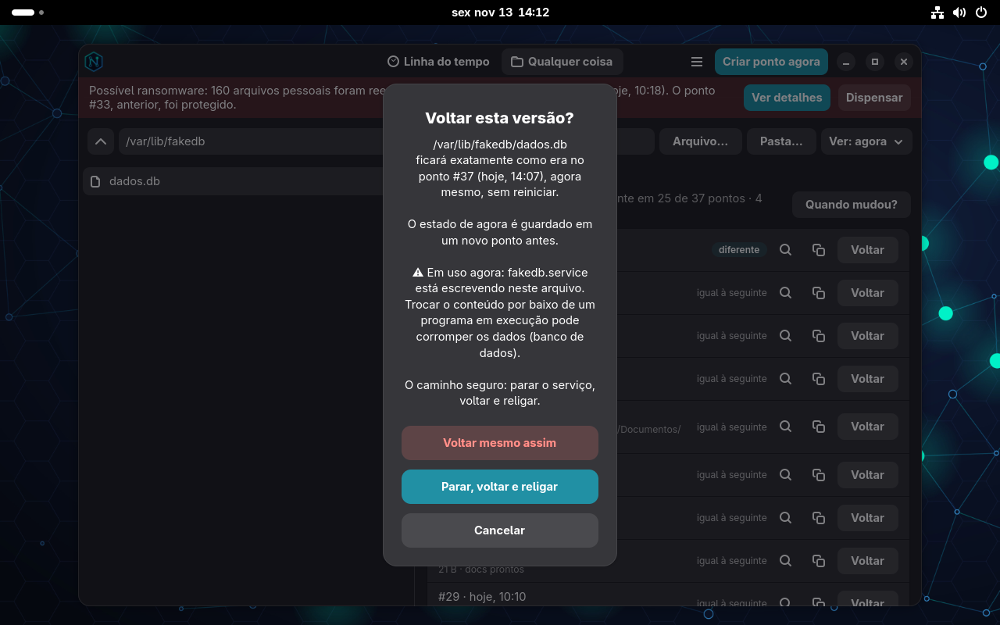
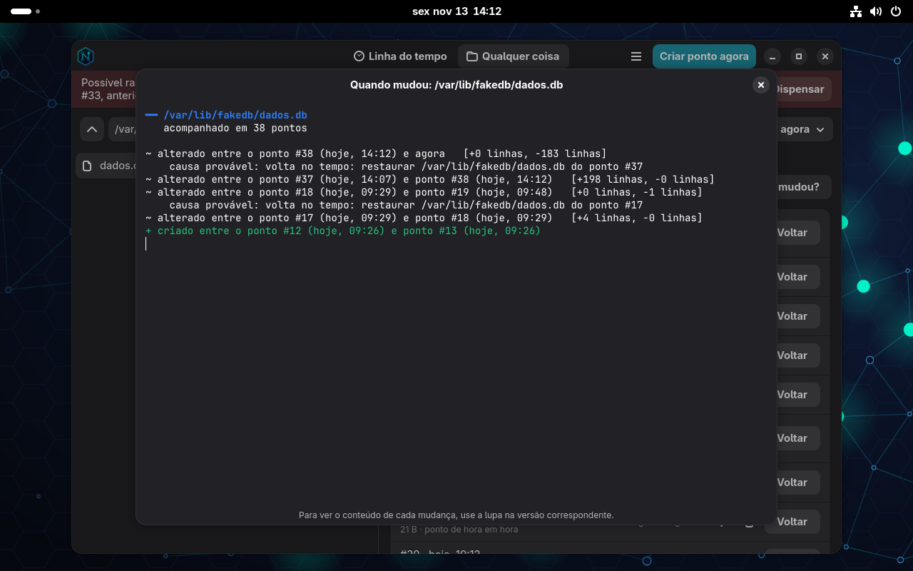
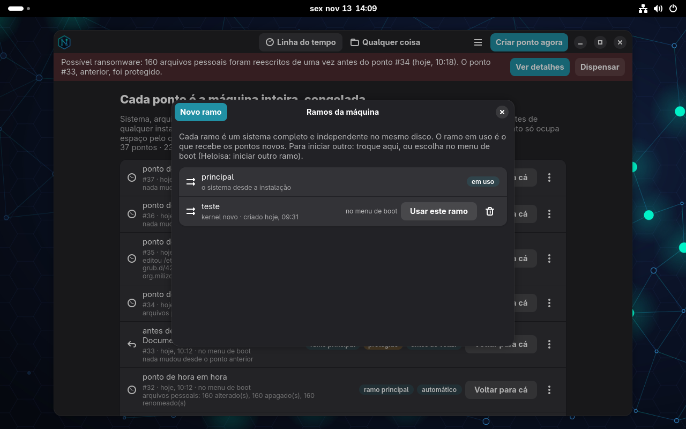
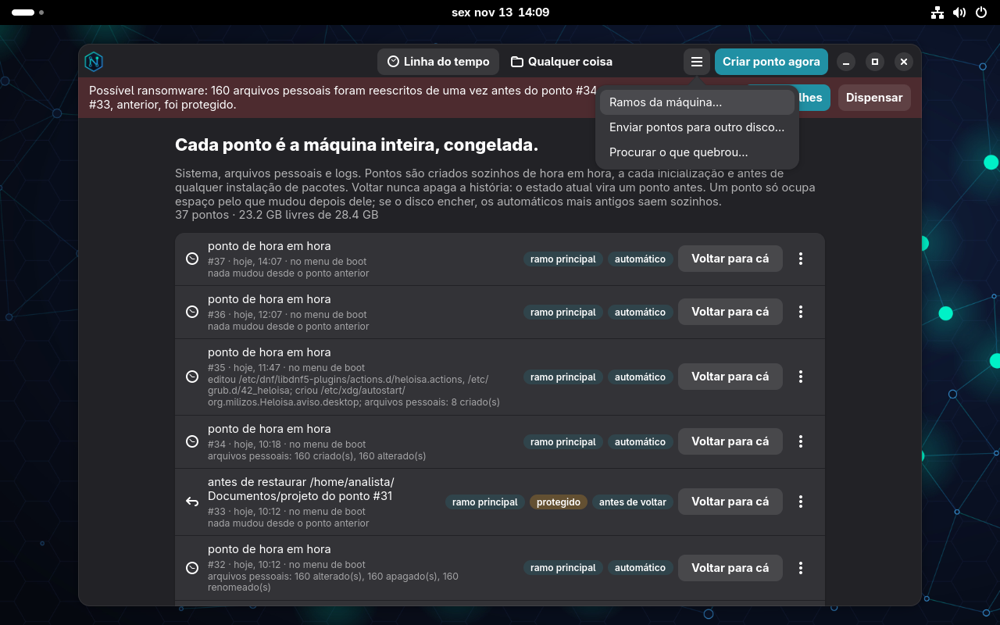
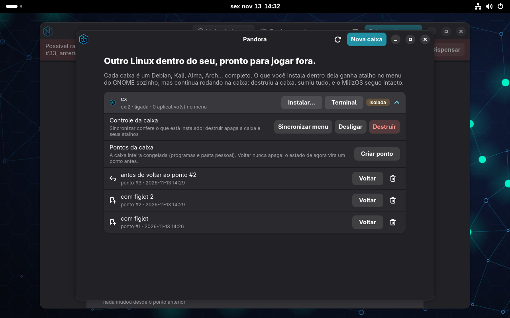

# Manual do MilizOS 2.1.0

O MilizOS não tem comando próprio para aprender. As ferramentas são as originais
(`nmap`, `suricata`, `tcpdump`, `btrfs`, `podman`, `dnf`…), cada uma com o seu nome e o seu
manual. O que o sistema acrescenta são dois aplicativos gráficos:

- **Heloisa**, a máquina do tempo: volta qualquer coisa a uma versão anterior.
- **Pandora**, as caixas Linux: Debian, Kali, Alma e outros, descartáveis, com atalhos no menu.

Índice: [Instalação](#instalação) · [Perfis](#perfis) · [Heloisa](#heloisa) ·
[Pandora](#pandora) · [Ferramentas](#ferramentas) · [Sensor IDS](#sensor-ids) ·
[Memória](#memória)

## Instalação

1. Grave a ISO em um pendrive (`dd`, Fedora Media Writer, Ventoy, balenaEtcher).
2. Inicie por ele. O menu oferece: iniciar (live / instalar), modo gráfico seguro,
   modo texto e instalação desassistida.
3. No modo live o instalador abre sozinho. Escolha idioma, disco, usuário e perfil.

Requisitos: x86-64, **4 GB de RAM**, 30 GB de disco.

O instalador cria uma tabela GPT que inicia em BIOS e em UEFI (com Secure Boot), e oferece:

| Opção | Escolhas |
|---|---|
| Sistema de arquivos | **btrfs** (padrão; é o que dá a linha do tempo), xfs, ext4 |
| Criptografia | LUKS2 no disco inteiro, opcional |
| Perfil | SOC, Redes ou Sensor |

> A Heloisa **exige btrfs**. Em xfs ou ext4 o sistema funciona, mas sem voltar no tempo.

### Instalação desassistida

Grave um `autoinstall.json` na pasta `milizos/` da mídia e escolha "instalação
desassistida" no menu de boot:

```json
{"disk": "auto", "filesystem": "btrfs", "encrypt": false, "passphrase": "",
 "hostname": "sensor01", "locale": "pt_BR.UTF-8", "keymap": "br",
 "timezone": "America/Sao_Paulo", "profile": "sensor",
 "user": {"name": "soc", "fullname": "SOC", "password_hash": "$6$...", "admin": true}}
```

- `"disk": "auto"` usa o maior disco interno; ou informe um caminho como `/dev/nvme0n1`.
- Em `user`, prefira `password_hash` (gere com `openssl passwd -6`) a `password`.

## Perfis

O perfil define quais serviços sobem. Para trocar depois, use o `systemctl` normalmente.

| Perfil | Para quem | O que liga |
|---|---|---|
| `soc` | Analista de SOC | Desktop, firewall, auditd |
| `neteng` | Engenharia de redes | Desktop, firewall, SSH, LLDP |
| `sensor` | Sensor de rede sem tela | Suricata, SSH, Cockpit (porta 9090) |

## Heloisa

O sistema é totalmente gravável: `dnf`, `/etc`, `/usr`, tudo pode ser alterado. A segurança
vem de outro lugar: **tudo tem história**, como em um repositório git.

### Pontos

Um **ponto** é a máquina inteira congelada em um instante: o sistema (`/`, com `/etc`,
`/usr` e `/var`), os arquivos pessoais (`/home`) e os logs (`/var/log`), mais o kernel e o
initramfs daquele momento. São snapshots btrfs: criar um leva menos de um segundo e só
ocupa espaço conforme os arquivos mudam.

Pontos nascem sozinhos:

| Quando | Tipo | Quantos ficam |
|---|---|---|
| Fim da instalação | instalação | para sempre |
| Antes de cada transação do `dnf` | pacotes | os 12 mais recentes |
| De hora em hora | automático | todos por 24 h, depois um por dia por 14 dias |
| Primeira inicialização do dia | inicialização | os 5 mais recentes |
| Antes de qualquer volta ou restauração | antes de voltar | os 12 mais recentes |
| Botão **Criar ponto agora** | manual | para sempre |

### Voltar a máquina

Na aba **Linha do tempo**, **Voltar para cá** deixa escolher o que volta: sistema,
arquivos pessoais, logs, ou qualquer combinação. O estado atual vira um ponto antes, então
a volta pode ser desfeita voltando para esse ponto. A troca vale ao reiniciar.

O menu de cada ponto também mostra **o que mudou desde então** (pacotes que entraram,
saíram ou mudaram de versão, e arquivos de `/etc`) e permite **explorar os arquivos** como
eram.

### Voltar qualquer coisa

A aba **Qualquer coisa** navega por todo o sistema de arquivos. Selecione um arquivo ou
pasta (ou digite o caminho) e a Heloisa lista todas as versões que ele teve:

- 🔍 compara a versão com o estado de agora (diff colorido para texto);
- 📄 traz uma **cópia** ao lado do original (`arquivo.ponto-12`), sem mexer no atual;
- **Voltar** deixa o caminho *exatamente* como era — numa pasta, o que foi criado depois
  some e o que foi apagado reaparece. Antes disso o estado atual vira um ponto.

O seletor **Ver:** mostra as pastas como eram em um ponto, e é assim que se acha o que foi
apagado. Também dá para abrir direto de um caminho: `heloisa /etc/ssh/sshd_config`.

### Pelo menu de boot

O GRUB tem o submenu **Heloisa: voltar o sistema no tempo** com os 15 pontos mais
recentes. Escolher um inicia o sistema daquele ponto, com o kernel daquele ponto; o
sistema que estava quebrado é preservado como um novo ponto.

### Resgate pela mídia

Se nem o GRUB sobrou, inicie pelo pendrive e abra a Heloisa. Em modo live ela procura
instalações nos discos, restaura o ponto escolhido e reconstrói `/boot` e o GRUB. Para um
disco criptografado, desbloqueie-o antes no app Arquivos ou Discos.

### Sem a Heloisa

Nada é formato próprio. Os pontos ficam montados, somente leitura, em **`/.heloisa`**:

```bash
ls /.heloisa/                                   # um diretório por ponto
cat /.heloisa/12/info.json                      # quando e por quê
diff -u /.heloisa/12/root/etc/fstab /etc/fstab
sudo cp -a /.heloisa/12/home/ana/relatorio.odt ~/
sudo btrfs subvolume list /
```

### Arquivo em uso

Voltar um arquivo ou uma pasta **não reinicia nada**: a troca é na hora. O cuidado é outro:
se um programa está escrevendo no arquivo (um banco de dados, uma máquina virtual), trocar
o conteúdo por baixo dele pode corromper os dados.

Antes de voltar, a Heloisa confere quem está com o caminho aberto para escrita. Se achar
alguém, mostra o aviso e três opções:

- **Parar, voltar e religar** (o recomendado): para só os serviços que estão escrevendo,
  troca o arquivo e liga os serviços de novo.
- **Voltar mesmo assim**: por sua conta.
- **Cancelar**.

Programas que não são serviços (um editor aberto, por exemplo) são apenas listados: feche
antes. Pastas de dados vivos (`/var/lib/mysql`, `/var/lib/pgsql`, imagens de VM e
arquivos `.db`, `.sqlite`, `.qcow2`) recebem o aviso mesmo sem ninguém escrevendo na hora.



### O que mudou e quando

- **Resumo do ponto.** Cada ponto traz, na linha do tempo, o que mudou desde o anterior:
  arquivos de configuração editados, criados e apagados, e quantos arquivos pessoais foram
  criados, alterados, apagados ou renomeados.
- **Quando mudou?** Na aba *Qualquer coisa*, com um arquivo selecionado, o botão mostra
  entre quais pontos ele foi criado, alterado ou apagado, quantas linhas entraram e saíram
  e a causa provável (um `dnf`, uma volta, uma edição).



### Procurar o que quebrou

Algo funcionava na semana passada e hoje não funciona. No menu de um ponto em que
**funcionava**, escolha *Aqui funcionava: procurar o que quebrou*.

1. A Heloisa escolhe o ponto do meio e pede para reiniciar nele.
2. Você testa e responde na barra que aparece no aplicativo: **Funciona** ou **Não funciona**.
3. Ela corta o intervalo pela metade e repete. Com 30 pontos são 5 reinicializações.
4. No fim, mostra o ponto em que o problema entrou, com os arquivos e pacotes que mudaram
   nele, e devolve a máquina ao sistema em que você estava.

A busca troca só o **sistema**; arquivos pessoais e logs ficam como estão. Durante a busca
os pontos automáticos ficam em pausa, e dá para cancelar a qualquer momento.

### Ramos da máquina

Um **ramo** é um segundo sistema completo no mesmo disco, que nasce como cópia instantânea
do sistema atual ou de um ponto. Serve para testar um kernel, um driver ou uma mudança
grande sem arriscar o sistema do dia a dia.

- Criar: menu principal, *Ramos da máquina*, **Novo ramo**; ou, no menu de um ponto,
  *Criar um ramo a partir deste ponto*.
- Trocar: **Usar este ramo** (vale ao reiniciar), ou o submenu *Heloisa: iniciar outro
  ramo da máquina* do GRUB.
- O ramo em uso recebe os pontos novos, e cada ponto mostra de que ramo veio.
- Os arquivos pessoais e os logs são os mesmos em todos os ramos.
- O limite é de 6 ramos. Apagar um ramo não tem volta.



### Experimentar um ponto

*Experimentar este ponto sem voltar* abre um terminal dentro de uma cópia descartável do
sistema e dos arquivos pessoais daquele ponto. Dá para olhar, rodar programas e até
quebrar: ao sair (`exit`), a cópia é apagada e a máquina atual não mudou em nada. Serviços
do ponto não são iniciados; é um terminal, não uma máquina virtual.

### Selar e proteger

- **Proteger** marca o ponto para nunca ser apagado sozinho.
- **Selar** calcula o SHA-256 de todos os arquivos do ponto e assina o resultado com uma
  chave da máquina. Guarde o hash fora dela (e-mail, chamado). Depois, *Selar* no mesmo
  ponto confere: se um byte mudou, a Heloisa diz quais arquivos diferem. Serve para provar
  o estado de uma máquina em um incidente ou auditoria.

Selar lê o ponto inteiro: leva de segundos a minutos, conforme o tamanho.

### Enviar os pontos para outro disco

Os pontos vivem no mesmo disco do sistema. Para sobreviverem à morte dele, envie-os:
menu principal, *Enviar pontos para outro disco*.

- **Disco externo**: formate em btrfs e monte pelo app Arquivos. Ele aparece na lista.
- **Servidor**: `ssh://root@servidor/caminho`, em um volume btrfs, usando a chave SSH do
  root desta máquina.

O primeiro envio leva tudo; os seguintes, só o que mudou. Pontos enviados ganham a marca
*enviado*, e o mais recente deles nunca é apagado sozinho (é a base do próximo envio).

### Clonar a máquina

Com os pontos em outro disco, dá para montar uma máquina igual em outro computador:

1. Inicie o computador novo pelo pendrive do MilizOS, com o disco de backup conectado.
2. Abra a Heloisa e escolha **Clonar de uma cópia**.
3. Escolha a cópia, o ponto, o disco de destino e o nome da nova máquina.

O clone recebe o sistema e os arquivos pessoais daquele ponto, com usuários e senhas da
origem, mas com nome próprio, novas chaves SSH e novo identificador de máquina. O disco de
destino é apagado.

### Alarme de ransomware

A cada ponto, a Heloisa olha o que mudou nos arquivos pessoais. Se cem ou mais arquivos
foram reescritos de uma vez e viraram dados sem padrão (o que a criptografia produz), ela:

1. avisa na sessão e mostra uma barra vermelha no aplicativo;
2. **protege o último ponto antes disso**, para ele não expirar;
3. mostra exemplos dos arquivos afetados e por onde recuperar.

É uma heurística sobre o que já aconteceu, não um antivírus: ela não impede o ataque, e
uma conversão em massa de arquivos (compactar uma pasta de fotos, por exemplo) também pode
dispará-la. O que ela garante é que você fica sabendo e que o ponto bom continua lá.



### Limites

- A única ação sem volta é **excluir um ponto** (ou um ramo).
- `/boot` (ext4) e a partição EFI não são fotografados; o kernel e o initramfs de cada
  ponto são guardados, e o resgate reconstrói o resto.
- Entre dois pontos automáticos pode passar até uma hora. Antes de algo arriscado, crie um
  ponto manual.
- Os pontos vivem no mesmo disco: protegem contra erro, atualização ruim e ransomware
  comum, não contra a morte do disco. Para isso, envie os pontos para outro disco.
- Um ransomware com acesso de root pode apagar os pontos locais. Os enviados para outro
  disco ou servidor ficam fora do alcance dele.

## Pandora

Uma **caixa** é outra distribuição Linux inteira rodando em um conteiner sem root
(podman + distrobox). Serve para usar uma ferramenta que só existe no Kali, testar um
pacote do Debian ou compilar algo no Alma sem sujar o MilizOS.

Distribuições prontas: Debian 13, Kali, AlmaLinux 9, Ubuntu 24.04, Fedora 44, Arch,
Rocky 9, openSUSE Tumbleweed, Alpine e Parrot. A imagem é baixada na criação.

### Atalhos automáticos

Instalou um programa dentro da caixa — pelo botão **Instalar…** ou no terminal dela, com
`apt`, `dnf`, `pacman`, `zypper` ou `apk` — e ele aparece no menu do GNOME em alguns
segundos, com o nome da caixa entre parênteses. Ele continua rodando **dentro da caixa**.
Desinstalou, o atalho some.

### Modos de rede

| Modo | O que a caixa alcança | Pasta pessoal |
|---|---|---|
| **Isolada** | Só a internet. Rede local, o host e endereços privados são recusados; nada entra | Própria, separada da sua |
| **Ponte** | A rede do host inteira: rede local, interfaces, portas, como um programa do host | A sua, compartilhada |

Use **Isolada** para o que você não confia; use **Ponte** para ferramentas que precisam
enxergar a rede (varredura, captura).

### Pontos da caixa

Abra a caixa na Pandora e use **Criar ponto** antes de uma mudança arriscada (um
`apt full-upgrade`, uma ferramenta que você não conhece). O ponto guarda a caixa inteira:
os programas instalados e, no modo isolado, a pasta pessoal dela.

**Voltar** recria a caixa como era naquele ponto. O estado de agora vira um ponto antes,
então dá para desfazer; os cinco mais recentes desse tipo são mantidos. O que estiver
rodando na caixa é encerrado.



### Destruir

**Destruir** apaga a caixa, tudo o que foi instalado nela, os atalhos do menu, os pontos e,
no modo isolado, a pasta pessoal dela. O MilizOS não é tocado.

### Sem a Pandora

As caixas são conteiners comuns: `podman ps -a`, `distrobox list` e
`distrobox enter NOME` funcionam. Os atalhos chamam
`/usr/libexec/milizos/pandora-enter NOME -- comando`, que liga a caixa e reaplica o
isolamento de rede antes de executar.

### Limites

- O modo **Ponte** compartilha a pilha de rede do host; a caixa não ganha um IP próprio na
  rede local (conteiner sem root não consegue isso).
- No modo **Isolada**, o filtro fica dentro da rede da caixa. Ele barra programas comuns;
  um processo que vire root *dentro da caixa* pode removê-lo. Para malware de verdade, use
  uma máquina virtual.
- A caixa enxerga o disco do host em `/run/host`. O isolamento é de rede e de pasta
  pessoal, não uma sandbox de segurança completa.

## Ferramentas

O menu do GNOME agrupa as ferramentas por categoria (tráfego, detecção, varredura,
diagnóstico, engenharia, forense, senhas, sem fio, hardening). As de terminal abrem um
shell já com a dica de `man` e `--help`. A lista completa está no [README](../README.md).

## Sensor IDS

No perfil `sensor`, o serviço `milizos-sensor-setup` escolhe a interface de captura e
prepara as regras antes de o Suricata subir. Depois disso, é o Suricata de sempre:

```bash
sudo suricata-update                 # atualiza as regras
sudo systemctl restart suricata
sudo tail -f /var/log/suricata/fast.log
```

## Memória

O MilizOS liga um swap comprimido em RAM (zram, zstd) do tamanho da memória e ajusta o
kernel para preferir comprimir páginas a descartar cache. É o que deixa o desktop completo
confortável em 4 GB. `zramctl` e `swapon` mostram o estado.
